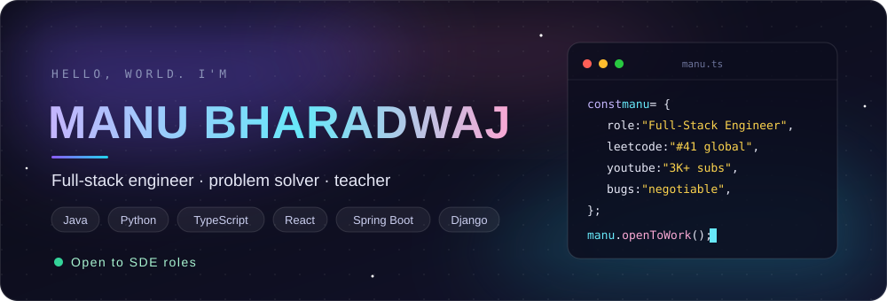
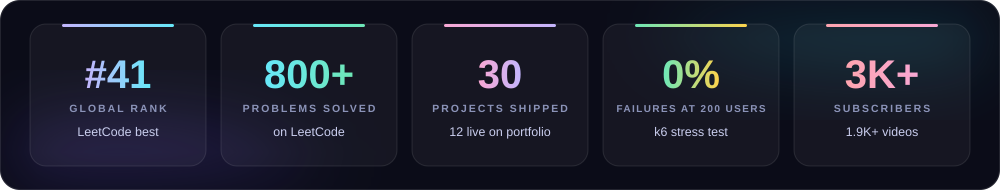

## Summary

Software Engineer with 2.5 years of experience building enterprise React applications and full-stack products with React, Angular, Spring Boot, Django and the MERN stack. I have delivered work for Dell, Intuit and JPMC, and I load-test what I ship: my recent projects ran with zero failures under stress on live deployments. Outside work, I solve problems at LeetCode Global Rank 41 and teach DSA and system design to a 3.32K-subscriber YouTube audience.

## At a Glance

| | |
|:--|:--|
| **Experience** | 2.5 years across Fractal Analytics, Allstate India, TechChef's Software and Fidelitus Corp |
| **Clients delivered for** | Dell, Intuit, JPMC |
| **Competitive coding** | LeetCode Best Global Rank 41, 800+ problems solved |
| **Performance** | k6 tested on live deployments: 0% failures up to 200 concurrent users, p95 latency 427 ms |
| **Projects** | 30 full-stack projects built, the best 12 live on my [portfolio](https://manu-bharadwaj-portfolio.vercel.app) |
| **System design** | 50 LLD and 10 HLD problems solved and open-sourced |
| **Teaching** | 3.32K subscribers, around 2,000 videos on DSA, CP and system design |
| **Looking for** | Software Engineer / SDE roles, full-stack or backend |

## Experience

**Full Stack Engineering Intern** · Fractal Analytics · *Jul 2025 – Oct 2025*
Delivered the Expense Splitter platform from design to deployment: 13 REST endpoints, JWT with role-based access control, three cloud services, stress tested to 200 concurrent users with 0% failures.

**Software Engineer** · Allstate India · *Nov 2022 – Mar 2023*
Built enterprise React reporting platforms for global stakeholders, bringing analytics and data-visualization workflows into one place and removing manual reporting and duplicate data pipelines. Strengthened CI/CD with pre-merge validation gates and deployment health checks, which cut rollbacks and sped up releases.

**Consultant** · TechChef's Software · *Sep 2021 – Nov 2022* · Clients: Dell, Intuit, JPMC
Architected a React Micro Frontend system so teams could deploy independently, removing release coupling and cutting deploy times. Built QuickBooks-integrated React and GraphQL modules, replacing over-fetching REST calls with schema-driven queries. Set up Jest and Enzyme testing from scratch and shipped WCAG-compliant, cross-browser UIs.

**Executive IT** · Fidelitus Corp · *Jan 2021 – Jul 2021*
Built reusable React components that enforced design-system conventions across internal enterprise platforms, and built secure authentication flows.

## Projects

### Expense Splitter: Group Expense Platform
`React 19` `Django REST Framework` `PostgreSQL` `JWT` `RBAC` `Material UI` `k6`

Built during my Fractal Analytics internship and deployed across Vercel, Render and Neon.

- 13 REST endpoints (9 for groups, members, expenses and summaries, 4 for auth)
- Equal and custom split modes with server-side validation: minimum 2 members, valid membership, full coverage, amounts summing within INR 0.01
- JWT authentication (SimpleJWT login, registration, refresh) and RBAC on every route
- Responsive Material UI frontend with four views: dashboard, expense form, expense list and balance summary

| Test | Setup | Result |
|:--|:--|:--|
| Load | 5 min, 50 concurrent users, 5 read endpoints | 41,127 requests, 0% failures, 137 req/s, 17 ms average, 48 ms p95 |
| Stress | 6 min, ramp to 200 users (+300%) | 101,002 requests, 0% failures, throughput up 105% to 280 req/s, p95 427 ms (14% under the 500 ms target) |

Result: gradual degradation under pressure, never failure.

### URL Shortener (Bharadwaj.ly): Full-Stack Platform
`Spring Boot` `React + Vite` `PostgreSQL` `JWT` `Docker` `Tailwind` `Material UI` `k6`

Deployed across Vercel, Render and Neon.

- Layered Controller, Service and Repository backend (Spring Data JPA, Hibernate) with stateless JWT authentication through a custom Spring Security filter, a role claim and 48-hour expiry
- Dockerized backend with 7 environment variables, zero hardcoded secrets and CORS restricted to one origin
- REST APIs for registration, login, 8-character short codes, link listing and public HTTP 302 redirects
- Load tested on the live deployment (Render free tier, from India, 3 runs, about 9 minutes): 6,329 requests, 99.95% success, 12,013 of 12,013 checks passed, including all 5,693 redirects returning 3xx with a Location header
- Saturation identified and documented: from 20 to 50 users, throughput rose 63% while p95 rose 158% (2.71 s at 50 users), with 0 errors
- k6 script with 5 test profiles, a 90/10 redirect-to-list mix, free-tier warm-up, p95 and error-rate thresholds, and a setup step that logs in, seeds a short URL and verifies its redirect

### 30 Full-Stack Projects
JWT and OTP authentication systems (MrAuthy), an E-Shop with Stripe payments, AI apps and more, built mainly in React with Next.js, Angular, Spring Boot, Django, MERN and MEAN. The 12 best are on my [portfolio](https://manu-bharadwaj-portfolio.vercel.app).

## Technical Skills

| | |
|:--|:--|
| **Languages** | Java, Python, JavaScript, TypeScript, HTML, CSS |
| **Frontend** | React, Next.js, Angular, Micro Frontends, Jest, Enzyme |
| **Backend** | Spring Boot, Django, FastAPI, Node.js, Express.js, REST APIs, GraphQL, Microservices |
| **Databases** | PostgreSQL, MySQL, MS SQL, MongoDB |
| **DevOps and Testing** | Docker, Jenkins, AWS EC2, Git, CI/CD, k6 |
| **Core Concepts** | Data Structures, Algorithms, Low-Level Design, High-Level Design, OOP |

## Competitive Programming

<table align="center">
<tr>
<td align="center"><b>Main account</b> · <a href="https://leetcode.com/u/mbbn/">mbbn</a> Java, Python · Best Global Rank 41</td>
<td align="center"><b>Previous account</b> · <a href="https://leetcode.com/u/Manu-Bharadwaj-BN/">Manu-Bharadwaj-BN</a> JavaScript</td>
</tr>
<tr>
<td></td>
<td></td>
</tr>
<tr>
<td></td>
<td></td>
</tr>
</table>

Cards refresh automatically after every contest.

## Open Source

| Repository | Contents | Languages |
|:--|:--|:--|
| [50 LLD Problems Solved](https://github.com/Manu577228/50-LLD-Problems-Solved) | 50 low-level design problems, each explained on YouTube | Java, Python |
| [Important HLD Problems](https://github.com/Manu577228/Important-HLD-Problems) | 10 system design classics: WhatsApp, Uber, TinyURL, Dream11, Zomato and more | Design docs |
| [CP Core Algorithms 150](https://github.com/Manu577228/CP-Core-Algorithms-150) | 150 advanced algorithms and 25+ extreme algorithms on niche topics | Java, Python |

## Teaching

[**@code-with-Bharadwaj**](https://www.youtube.com/@code-with-Bharadwaj) on YouTube: 3.32K subscribers and around 2,000 videos covering DSA, competitive programming, advanced algorithms and system design, with series in Java, Python and JavaScript. Explaining hard problems clearly on camera is the same skill I bring to design docs, code reviews and onboarding.

## GitHub Stats

## Education

Bachelor of Engineering · Visvesvaraya Technological University · 2018

## Contact

I'm open to Software Engineer and SDE roles. Send me a problem and I'll send back a solution, a deployment and a load test.

**[bnmanubharadwaj@gmail.com](mailto:bnmanubharadwaj@gmail.com)** &nbsp;|&nbsp; [LinkedIn](https://www.linkedin.com/in/manu-bharadwaj-3507a345) &nbsp;|&nbsp; [Portfolio](https://manu-bharadwaj-portfolio.vercel.app)

