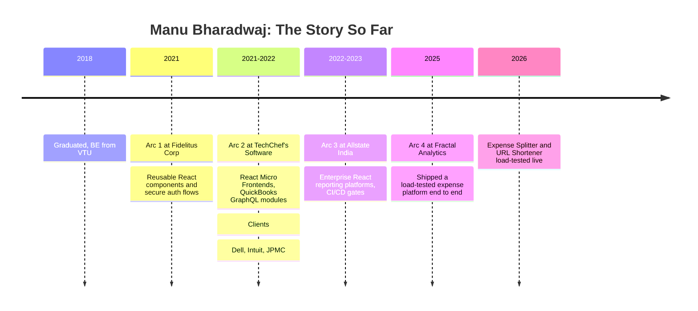
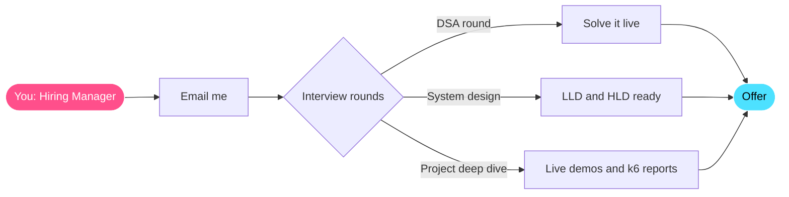

 

## Prologue: The 10-Second Pitch

> **Recruiters: if you only read one section, read this one.**

| You need someone who... | Here's the proof |
|:--|:--|
| **Ships real products** | 30 full-stack projects built, the best 12 live on my [portfolio](https://manu-bharadwaj-portfolio.vercel.app) |
| **Builds things that don't fall over** | k6 tested on live deployments: **0% failures up to 200 concurrent users**, p95 latency **427 ms** |
| **Has real industry experience** | **2.5 years** across Fractal Analytics, Allstate India and TechChef's Software |
| **Has delivered for big-name clients** | Built for **Dell, Intuit and JPMC** at TechChef's Software, and enterprise reporting platforms at **Allstate India** |
| **Is technically elite** | LeetCode **Best Global Rank 41**, **800+** problems solved |
| **Communicates and mentors** | **3.32K** YouTube subscribers, **~2,000** videos on DSA, CP and System Design |
| **Speaks your team's language** | English · हिन्दी · ಕನ್ನಡ |
| **Thinks in systems** | **50** LLD + **10** HLD designs open-sourced, each with a video walkthrough |

### 📬 **[bnmanubharadwaj@gmail.com](mailto:bnmanubharadwaj@gmail.com)**
*Replies fast. Interviews gladly.*

## Chapter 1: Character Sheet

Bars are a stylised view of the real numbers beside them. The numbers are what count.

## Chapter 2: Passive Skills (Why Teams Hire Me and Keep Me)

<table>
<tr>
<td width="33%" valign="top">

### ⚔️ Full-Stack Combo
Frontend, backend, database, auth, deployment and load testing. I deliver a working, deployed, measured result, not a half-built feature.

</td>
<td width="33%" valign="top">

### 🧠 Strategist Mind
Years of explaining algorithms and design problems on camera taught me to split big problems into clean parts. I design first, weigh trade-offs, then build.

</td>
<td width="33%" valign="top">

### 🤝 Party Support
I write things down, explain things clearly and help people get unstuck. Teaching about 2,000 videos' worth of material is a habit I bring to code reviews and onboarding.

</td>
</tr>
</table>

## Chapter 3: Boss Fights (Projects That Run in Production)

> Not demos that live on my laptop. Deployed, load-tested and documented.

### 👹 Boss 1: Expense Splitter (Group Expense Platform)
`React 19` `Django REST Framework` `PostgreSQL` `JWT` `RBAC` `Material UI` `k6` `Vercel` `Render` `Neon`

Splits bills so friendships survive dinner. Built during my **Fractal Analytics** internship.

- **13 REST endpoints** (9 for groups, members, expenses and summaries, plus 4 for auth), deployed across **3 cloud services**
- **Equal and custom split modes** with server-side validation (minimum 2 members, valid membership, full coverage, amounts summing within INR 0.01)
- **JWT auth** (SimpleJWT login, registration, refresh) with **RBAC** on every route
- Responsive Material UI frontend with 4 views: dashboard, expense form, expense list, balance summary

<b>⚔️ Battle log: k6 results (click to expand)</b>

 

| Test | Setup | Result |
|:--|:--|:--|
| **Load test** | 5 min, 50 concurrent users, 5 read endpoints | 41,127 requests, **0% failures**, 137 req/s, 17 ms average, **48 ms p95** |
| **Stress test** | 6 min, ramp to 200 users (+300%) | 101,002 requests, **0% failures**, throughput up 105% to 280 req/s, **p95 427 ms** (14% under the 500 ms target) |

Result: gradual degradation under pressure, never failure.

### 👹 Boss 2: URL Shortener (Bharadwaj.ly)
`Spring Boot` `React + Vite` `PostgreSQL` `JWT` `Docker` `Tailwind` `Material UI` `k6`

Because long URLs are a cry for help.

- Clean **Controller → Service → Repository** backend (Spring Data JPA, Hibernate) with **stateless JWT auth** via a custom Spring Security filter, role claim and 48-hour expiry
- **Dockerized**, 7 environment variables, **zero hardcoded secrets**, CORS restricted to 1 origin
- REST APIs for registration, login, **8-character short codes**, link listing and public **HTTP 302 redirects**
- Deployed across Vercel, Render and Neon

<b>⚔️ Battle log: k6 results (click to expand)</b>

 

Load tested on the **live deployment** (Render free tier, from India, 3 runs, about 9 minutes):

- **6,329 requests, 99.95% success**, 12,013 of 12,013 checks passed
- All **5,693 redirects** returned 3xx with a Location header
- Saturation point identified and documented: from 20 to 50 users, throughput rose 63% while p95 rose 158% (2.71 s at 50 users), with 0 errors
- k6 script with 5 test profiles, a 90/10 redirect-to-list mix, free-tier warm-up, p95 and error-rate thresholds, and a setup step that logs in, seeds a short URL and verifies its redirect

### 🗡️ Side Quests: 30 Full-Stack Projects
JWT and OTP auth systems (MrAuthy), an E-Shop with Stripe payments, AI apps and more, built mainly in React with Next.js, Angular, Spring Boot, Django, MERN and MEAN. The 12 best are on my [**portfolio**](https://manu-bharadwaj-portfolio.vercel.app).

<b>🔍 My checklist for every project (click to expand)</b>

 

1. **Design first:** layered architecture, clear boundaries, no spaghetti.
2. **Secure by default:** JWT, RBAC, server-side validation, no secrets in code.
3. **Ship it:** every project is deployed so you can click it, not just read about it.
4. **Measure it:** k6 load and stress tests with real numbers and documented limits.
5. **Document it:** README, resume-ready write-up and live links.

## Chapter 4: Story Arcs (Career Timeline)

### 🏯 Guild History

**🔹 Full Stack Engineering Intern · Fractal Analytics** · Jul 2025 – Oct 2025
Delivered the Expense Splitter platform from design to deployment: 13 REST endpoints, JWT and RBAC, 3 cloud services, stress tested to 200 concurrent users with 0% failures.

**🔹 Software Engineer · Allstate India** · Nov 2022 – Mar 2023
Built enterprise React reporting platforms for global stakeholders, bringing analytics and data-visualization workflows into one place and removing manual reporting and duplicate data pipelines. Strengthened CI/CD with pre-merge validation gates and deployment health checks, which cut rollbacks and sped up releases.

**🔹 Consultant · TechChef's Software** · Sep 2021 – Nov 2022 · *Clients: Dell, Intuit, JPMC*
Architected a React Micro Frontend system so teams could deploy independently, removing release coupling and cutting deploy times. Built QuickBooks-integrated React and GraphQL modules, replacing over-fetching REST calls with schema-driven queries. Set up Jest and Enzyme from scratch and shipped WCAG-compliant, cross-browser UIs.

**🔹 Executive IT · Fidelitus Corp** · Jan 2021 – Jul 2021
Built reusable React components that enforced design-system conventions across internal enterprise platforms, and secure authentication flows.

**🎓 Education:** Bachelor of Engineering, Visvesvaraya Technological University (2018)

## Chapter 5: Skill Scrolls (Tech Arsenal)

<table>
<tr><td><b>⚡ Languages</b></td><td>

</td></tr>
<tr><td><b>🎨 Frontend</b></td><td>

</td></tr>
<tr><td><b>⚙️ Backend</b></td><td>

</td></tr>
<tr><td><b>🗄️ Databases & DevOps</b></td><td>

</td></tr>
<tr><td><b>📜 Core Concepts</b></td><td>Data Structures · Algorithms · Low-Level Design · High-Level Design · System Design · OOP · REST APIs · Microservices · CI/CD · Performance Testing</td></tr>
</table>

## Chapter 6: Rival Board (Competitive Programming)

> Strong fundamentals aren't a slogan here. They're ranked.

### 🥇 Main account: [mbbn](https://leetcode.com/u/mbbn/) · Java, Python · Best Global Rank 41

### 🥈 Previous account: [Manu-Bharadwaj-BN](https://leetcode.com/u/Manu-Bharadwaj-BN/) · JavaScript

Cards refresh automatically after every contest.

**What this means for your team:** I can break down unfamiliar problems under time pressure, choose the right data structure and write clean, correct code on the first pass.

## Chapter 7: Sacred Scrolls (Open Source)

| Repo | What's inside | Languages |
|:--|:--|:--|
| 🏗️ [**50 LLD Problems Solved**](https://github.com/Manu577228/50-LLD-Problems-Solved) | 50 low-level design problems, each explained on YouTube | Java, Python |
| 🌐 [**Important HLD Problems**](https://github.com/Manu577228/Important-HLD-Problems) | 10 system design classics: WhatsApp, Uber, TinyURL, Dream11, Zomato and more | Design docs |
| 🧠 [**CP Core Algorithms 150**](https://github.com/Manu577228/CP-Core-Algorithms-150) | 150 advanced algorithms, plus 25+ extreme ones on niche topics | Java, Python |

Every repo ships with a video walkthrough, because code that teaches is worth more than code that merely exists.

## Chapter 8: Training Arc (I Teach This Stuff Too)

**3.32K subscribers · ~2,000 videos · Java, Python and JavaScript series**

DSA, competitive programming, advanced algorithms and system design, explained in plain language for beginners and interview candidates.

**Why that matters to an employer:** explaining Dijkstra without anyone crying is the same skill as explaining your codebase to a new teammate, writing a clear design doc or mentoring a junior engineer.

## Chapter 9: Status Window (GitHub Activity)

## Chapter 10: The Hiring Quest Route

## 📜 Scroll of Answers (Recruiter FAQ)

<b>What roles am I looking for?</b>

 
Software Engineer / SDE roles where I can build scalable full-stack products, own features end to end and keep growing in system design.

<b>Can I work across the stack?</b>

 
Yes. React, Next.js and Angular on the frontend. Spring Boot, Django, FastAPI and Node.js on the backend. PostgreSQL, MySQL, MongoDB and MS SQL for data. Docker, Jenkins and AWS EC2 for delivery.

<b>Do I have experience with large clients and enterprise codebases?</b>

 
Yes. I built enterprise React platforms at Allstate India and delivered work for Dell, Intuit and JPMC through TechChef's Software.

<b>How do I handle quality and performance?</b>

 
I test, then measure. My recent projects were load and stress tested with k6 on live deployments, with results and limits documented.

<b>Will I be good in a team?</b>

 
I've worked with teams at Fractal Analytics, Allstate India and TechChef's Software, delivering for clients like Dell, Intuit and JPMC. I also spend my free time teaching thousands of developers, so clear communication and helping others is second nature.

<b>What's the fastest way to reach me?</b>

 
Email <b>bnmanubharadwaj@gmail.com</b> or message me on <a href="https://www.linkedin.com/in/manu-bharadwaj-3507a345">LinkedIn</a>.

 

## ⚔️ Join My Party

### I'm open to SDE roles. Send me a problem. I'll send back a solution, a deployment and a load test.

**ನಮಸ್ಕಾರ · नमस्ते · Hello**

*ನಿಮ್ಮ ಸಂದೇಶಕ್ಕಾಗಿ ಕಾಯುತ್ತಿದ್ದೇನೆ · आपके संदेश की प्रतीक्षा रहेगी · Write to me in any of the three.*

*Time complexity of replying to recruiters: O(1). Space complexity of my coffee consumption: unbounded.* ☕

 

